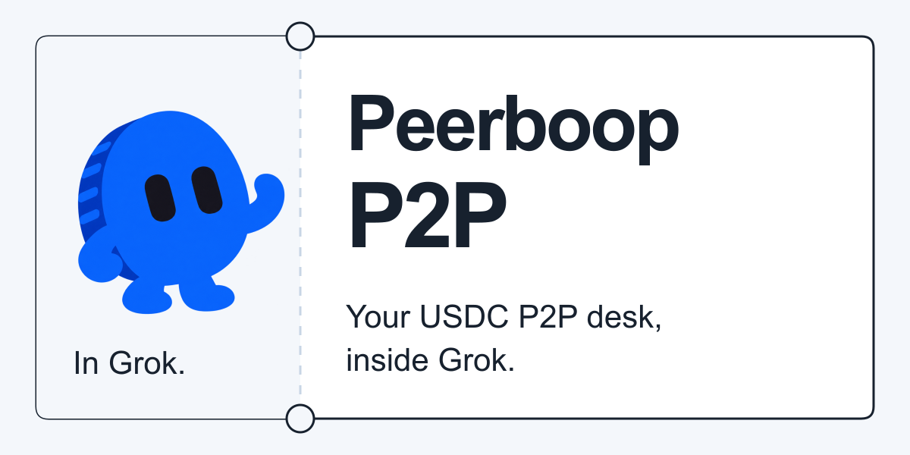
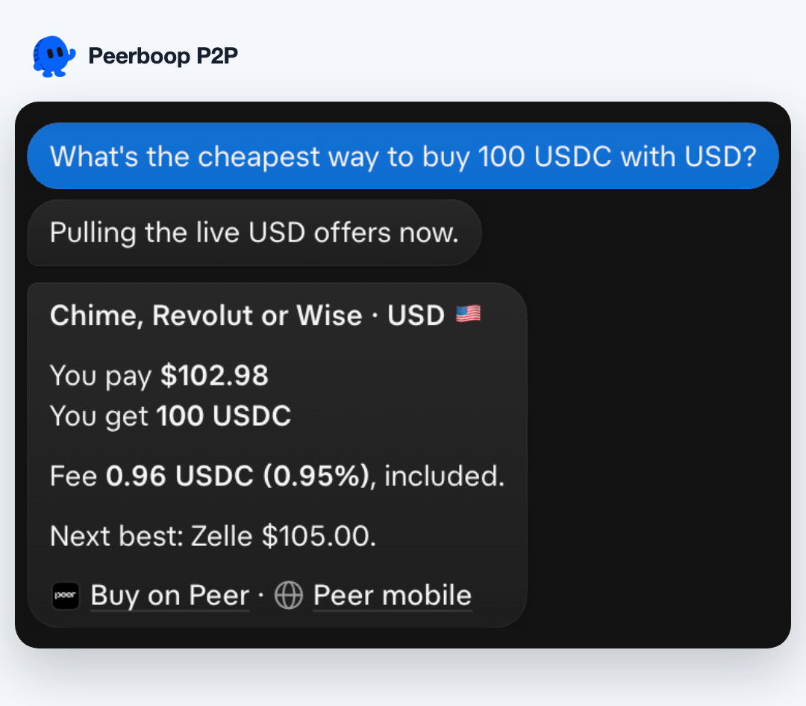
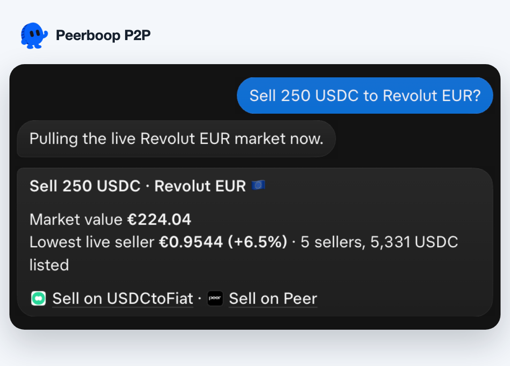
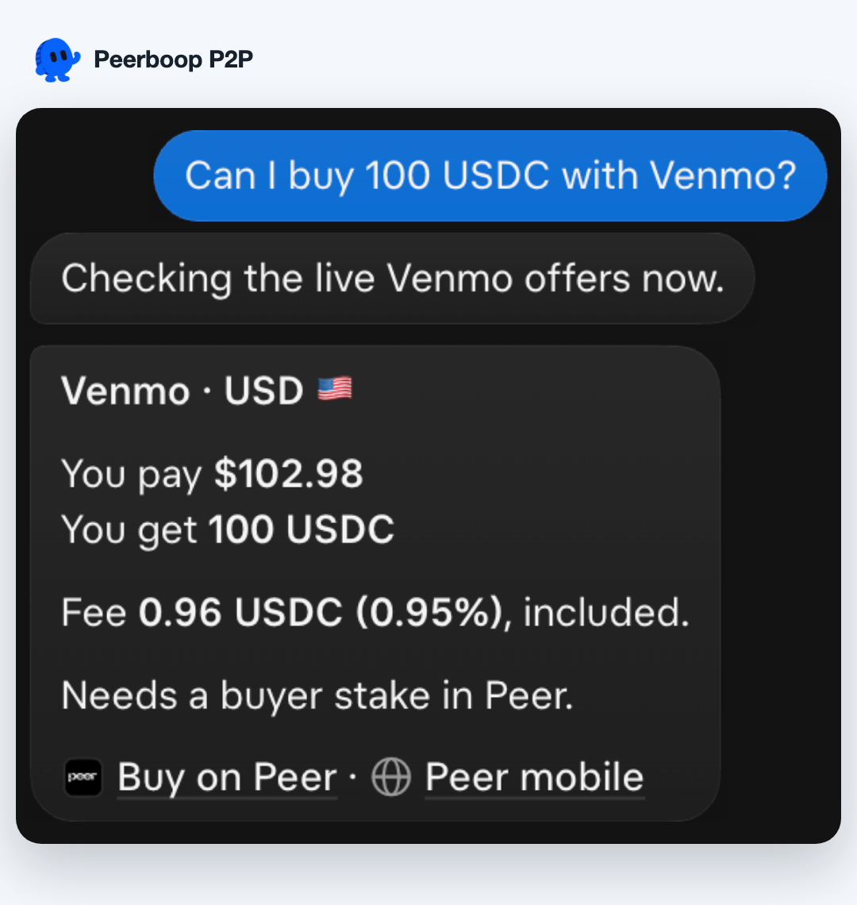
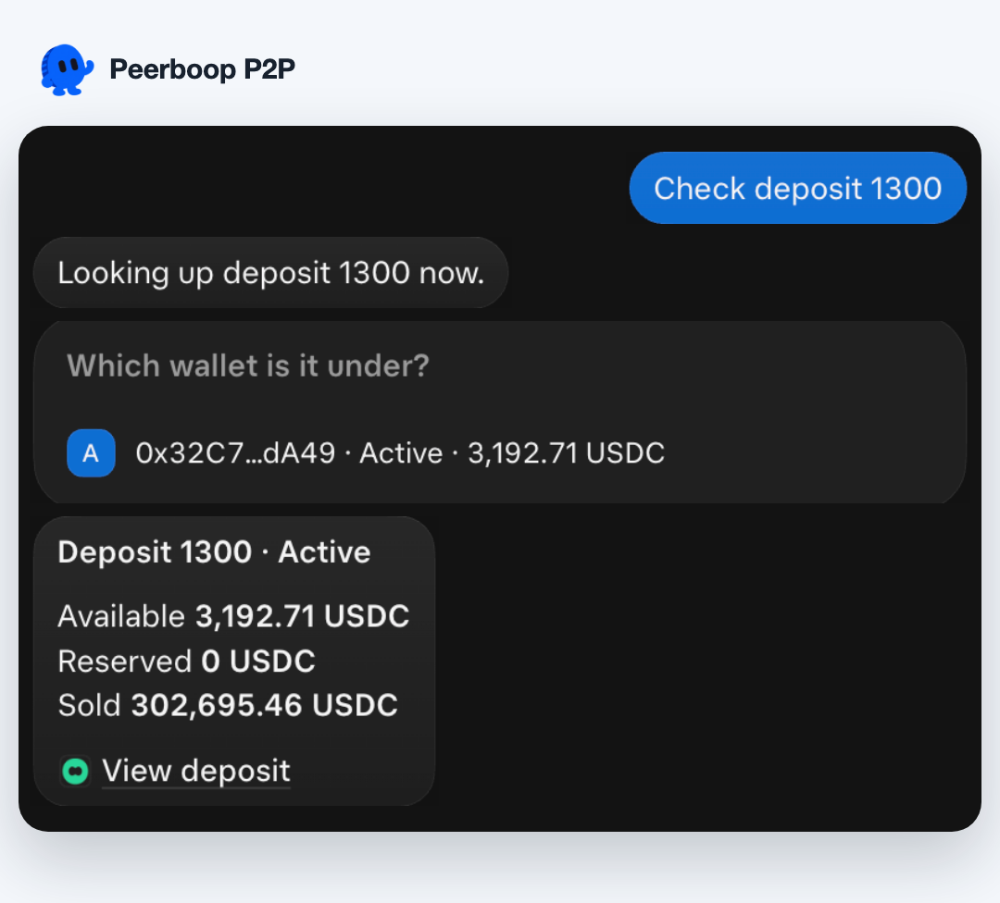

<p align="center">
  
</p>

<h1 align="center">Peerboop P2P</h1>

<p align="center"><strong>The cheapest way into USDC, one message away.</strong><br>Live Peer prices, every payment app, fee included. Inside Grok.</p>

<p align="center">
  <a href="https://x.ai/bot/OVV5tPy7c0yg5WyMfv6pj"></a>
</p>

<p align="center"><a href="https://x.ai/bot/OVV5tPy7c0yg5WyMfv6pj">x.ai/bot/OVV5tPy7c0yg5WyMfv6pj</a></p>

<p align="center">
  <a href="https://x.ai/bot/OVV5tPy7c0yg5WyMfv6pj"></a>
  <a href="skills/peerboop-p2p/manifest.json"></a>
  <a href="skills/peerboop-p2p/SKILL.md"></a>
  <a href="LICENSE"></a>
</p>

<p align="center">
  
</p>

**Ask in plain words, get the number.** Peerboop reads every live offer on Peer, the peer-to-peer USDC market, and tells you the cheapest payment app for your amount with the fee already in. Selling? It gives you the market value and the price to beat. Got a deposit? Paste the number.

- **Every payment app, live.** Revolut, Wise, Venmo, Cash App, Zelle, Monzo, PayPal and whatever lists next, read fresh for every question.
- **The real total.** You pay, you get, fee included. Integer maths, checked against the orderbook.
- **Zero setup.** No wallet, no keys, no sign-up to ask a price.
- **Always current.** One self-updating skill: merge to `main` and every opted-in bot runs the new version within minutes.

## More from the desk

Real answers from the published bot, captured **29 October 2026** and checked against the live orderbook and indexer. Grok’s brief “Pulling…” line before each answer is left in. [Capture notes](docs/launch/MEDIA.md).

<p align="center">
  
  
</p>
<p align="center">
  
  
</p>

## Take a seat

1. [Add Peerboop P2P to Grok](https://x.ai/bot/OVV5tPy7c0yg5WyMfv6pj).
2. Pick **Buy USDC**, **Sell USDC**, **Cheapest route today** or **Track a deposit**.
3. Or just ask: **“What’s the cheapest way to buy 100 USDC with USD?”**

Price checks need no wallet. Every figure is read live from Peer’s public market data for each question; there is no saved price list and no list of payment apps to go stale.

## What’s on the desk

| You want to… | Ask… |
| --- | --- |
| Buy at the best price | “Cheapest way to buy 100 USDC with GBP?” |
| Price a sale | “Sell 250 USDC to Revolut EUR?” |
| Use a particular app | “Can I buy 100 USDC with Venmo?” |
| See what’s live | “Which payment apps can I use with EUR?” |
| Follow a public deposit | “Check deposit 1300” or “Show deposits for 0x…” |
| Fix a stuck order | “I paid but verification failed. What do I do?” |

Replies lead with the amount: what you pay, what you get, the fee, and for sellers the market value and live competition on that route. Then the links.

### Where the numbers come from

| Data | Source |
| --- | --- |
| Prices, fees, limits, payment apps, eligibility | Peer’s public orderbook feed, built on the Peer indexer |
| Market value | Each offer’s premium over Peer’s onchain oracle, from the same feed |
| Deposits and balances | The Peer indexer through the public Peerlytics explorer API |

Offers that need a buyer stake (currently Venmo and PayPal) are open to every buyer, so they are priced and labelled. Whitelisted and seller-automated offers are left out.

### Go straight to the trade

| | Links |
| --- | --- |
| **Buy** | [Buy on Peer](https://app.peer.xyz/referrals?referralCode=TOFIAT) · [Peer mobile](https://mobile.peer.xyz/onboard?referralCode=TOFIAT) |
| **Sell** | [Sell on USDCtoFiat](https://usdctofiat.xyz) (prefilled with app, currency and amount) · [Sell on Peer](https://app.peer.xyz/referrals?referralCode=TOFIAT) |
| **Order help** | [Peer Support](https://support.peer.xyz) |

Peer links carry **TOFIAT**; USDCtoFiat applies it internally. The desk adds **no fee**.

## One skill. Your Grok.

The whole bot is [**SKILL.md**](skills/peerboop-p2p/SKILL.md): readable Markdown that runs on Grok’s own public reads and optional Routines. It runs no backend, holds no funds, creates no orders and never asks for keys or bank details.

**It keeps itself up to date.** Every installed bot checks [`manifest.json`](skills/peerboop-p2p/manifest.json) at the start of each turn. When `main` has a newer version, Peerboop offers it once in a single line. Reply **always update** and from then on it silently downloads each new skill, checks its SHA-256 and replaces its own copy. Grok asks for that one-time consent before a bot rewrites itself. The Grok template is published once; merging a new skill to `main` is the release. The safety limits (no trading, signing, funds, wallets or credentials, and TOFIAT on Peer links) live in the bot’s startup note, which an update cannot change.

```text
skills/peerboop-p2p/SKILL.md   The bot
docs/                         Design, sources and verification
skills/peerboop-p2p/manifest.json  Version and hash installed bots update from
```

## Make it better

```sh
python3 scripts/check-skill.py
python3 -m unittest discover -s tests
python3 scripts/release-manifest.py --check
```

If you have the Agent Skills validator installed, also run:

```sh
validate-agent-skills skills/peerboop-p2p
```

Try the changed answer in a separate Grok bot, reconcile its figures against the live orderbook and follow the actual links. [Contributing](CONTRIBUTING.md) covers voice, source checks and a small real-user test set. [Verification notes](docs/BUILD.md) distinguish live evidence from capabilities that still need testing.

Built by **Galleon Labs**, created by **Andrew Wilkinson**. An independent project built on Peer’s public market data; not official Peer support. [MIT licensed](LICENSE).
